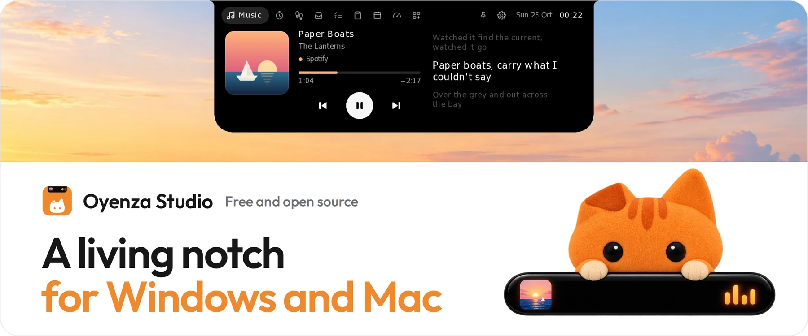
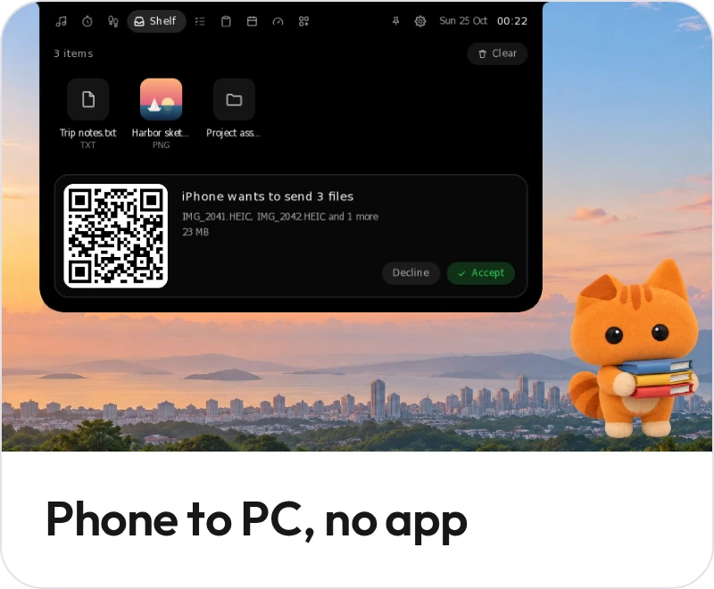
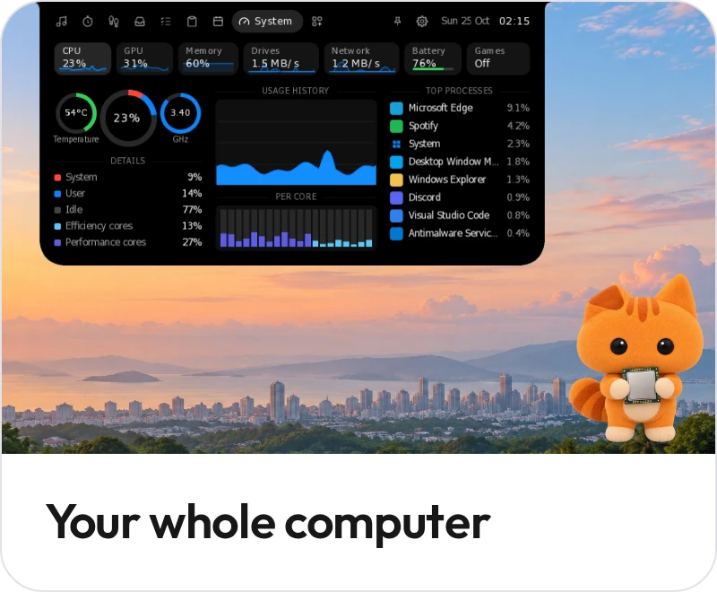

I'm building **[Oyenza Studio](https://github.com/lucacadalora/oyenza-studio)**, the Dynamic Island for your computer. A small island hangs from the top of your screen: music with lyrics in time, a focus timer, a shelf your phone drops files into, and live system stats. Native Rust, free and open source.

  
  
  

  
  
  

Windows 10 and 11 &nbsp;·&nbsp; macOS 14 or later &nbsp;·&nbsp; No account needed
